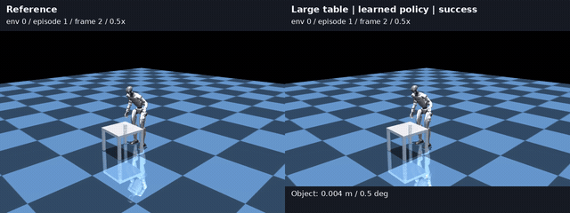
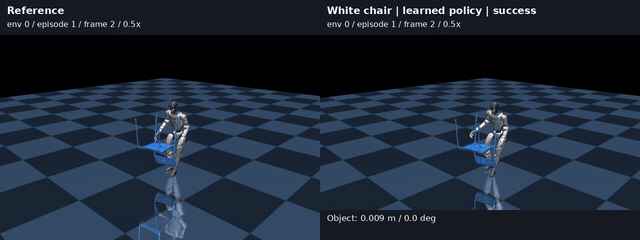

# G1 全身交互训练

使用 Semantic B4 + Anchor-Force 重定向轨迹，在 Isaac Sim 中训练 Unitree G1 29DoF 的物体交互策略。这里记录我们使用的训练启动方式，以及 Large table、White chair 两个任务的成功回合。

## 成功 episode

点击动图打开完整 MP4。左侧是重定向参考，右侧是训练后的策略；两段均为 Isaac Sim 评测 rollout 的 MuJoCo 离线回放，按 **0.5 倍速**播放。

| Large table · `sub1_largetable_028` | White chair · `sub10_whitechair_118` |
| --- | --- |
| [](assets/demos/largetable-success.mp4?raw=1) | [](assets/demos/whitechair-success.mp4?raw=1) |
| [完整视频](assets/demos/largetable-success.mp4?raw=1) · G2 · checkpoint **28,500** | [完整视频](assets/demos/whitechair-success.mp4?raw=1) · G2 · checkpoint **16,500** |
| **313 / 320（97.81%）** | **297 / 320（92.81%）** |

两段视频均取各自评测中 **env 0 / episode 1** 的成功回合。G2 使用 B4+force 参考轨迹、original-adaptive 采样和基础跟踪奖励。表中成功率来自对应 checkpoint 的完整评测：seed 42，32 个环境，每环境前 10 个完成回合，保留成功和失败回合，开启推扰动，从参考起点运行到结束。这是各任务选定 checkpoint 的结果。

视频模型使用历史 Actor160 / Critic298。当前主分支新训练使用 Actor154 / Critic298；下面的命令启动当前结构的新训练，不能把这两个历史模型直接作为当前结构的续训 checkpoint。

## 环境

训练环境：Ubuntu 22.04+、NVIDIA GPU；本工作区使用 RTX 5090 / CUDA 12.8、Python 3.11、PyTorch 2.7.0+cu128、Isaac Sim 5.1.0、Isaac Lab 2.3.0。

在仓库根目录执行。Miniconda 默认安装于 `~/miniconda3`，其他位置先设置 `CONDA_ROOT`。

```bash
# 首次安装；已有 hssim 环境时跳过
bash scripts/setup_blackwell.sh training

# 每个新终端激活训练环境
source scripts/source_isaacsim_setup.sh
```

重定向使用独立环境：`bash scripts/setup_blackwell.sh retargeting`，随后 `source scripts/source_retargeting_setup.sh`。两个环境的依赖清单位于 [`scripts/requirements/`](scripts/requirements/)。Isaac Sim 与 Tyro 的 `typing-extensions` 固定版本存在已知冲突，本环境使用 4.15.0；安装脚本只豁免这一项 `pip check` 报告。

## 训练数据

训练需要转换为 **50 Hz RL 格式的 motion NPZ**，以及对应物体的 **URDF 和碰撞 mesh**。这些任务数据、checkpoint 和完整实验输出保存在本地，Git 仓库只收录上面的展示视频；新机器需要先同步数据并修正 URDF 内的 mesh 路径。

原始 InterMimic 人体/物体轨迹放在 `src/holosoma_retargeting/holosoma_retargeting/demo_data/omomo/official_inputs/<task>.pt`，供重定向使用。下面的 `MOTION` 应指向已转换的 RL 输入。

在仓库根目录选择一个任务，设置变量。

**Large table：**

```bash
TASK=sub1_largetable_028
MOTION="$PWD/exp/training/$TASK/rubber_support_w1000_originalrl_20261005/inputs/semantic_b4_force_affordance_w1000.npz"
OBJECT_URDF="$PWD/exp/training/$TASK/force_affordance_b4_originalhand_auto_originalrl_20261005/inputs/largetable.urdf"
```

**White chair：**

```bash
TASK=sub10_whitechair_118
MOTION="$PWD/exp/training/$TASK/force_affordance_rubber_support_w1000_three_group_20261006/inputs/semantic_b4_force_w1000_50hz.npz"
OBJECT_URDF="$PWD/src/holosoma_retargeting/holosoma_retargeting/demo_data/models/whitechair/whitechair.urdf"
```

以上是成功实验使用的本地输入位置。同步到其他目录时，修改 `MOTION` 和 `OBJECT_URDF`；Large table 使用配套的 compound collision 资产。

## 启动训练

用 tmux 保持训练会话。先在仓库根目录创建会话，再在 **tmux 内**激活环境，并执行上面所选任务的变量设置：

```bash
tmux new -s g1_train
source scripts/source_isaacsim_setup.sh
# 在这里执行上面的 TASK / MOTION / OBJECT_URDF 设置
```

确认输入存在后启动。默认使用 GPU 0、seed 42、4096 个环境，训练 30,000 iterations，每 500 次保存 checkpoint。

```bash
test -f "$MOTION" && test -f "$OBJECT_URDF" || { echo "训练输入不存在"; exit 1; }
export CUDA_VISIBLE_DEVICES=0
RUN_DIR="$PWD/exp/training/$TASK/manual_$(date +%Y%m%d_%H%M%S)"
mkdir -p "$RUN_DIR"
set -o pipefail

python src/holosoma/holosoma/train_agent.py \
  exp:g1-29dof-wbt-w-object-b4-s0-original-adaptive-paper-dr \
  simulator:isaacsim \
  logger:disabled \
  --training.headless True \
  --training.name "${TASK}_b4_originalrl" \
  --training.seed 42 \
  --training.num-envs 4096 \
  --algo.config.num-learning-iterations 30000 \
  --algo.config.save-interval 500 \
  --training.export-onnx True \
  --logger.base-dir "$RUN_DIR" \
  --logger.video.enabled False \
  --logger.video.upload-to-wandb False \
  --scene.rigid-objects.object.urdf-file "$OBJECT_URDF" \
  --command.setup-terms.motion-command.params.motion-config.motion-file "$MOTION" \
  2>&1 | tee "$RUN_DIR/train.log"
```

按 `Ctrl-b`，再按 `d` 离开 tmux，训练继续运行。用 `tmux attach -t g1_train` 重新连接。日志和模型保存在 `$RUN_DIR` 下；每次新训练创建独立目录。

需要 W&B 时，先执行 `wandb login`，再将 `logger:disabled` 换成 `logger:wandb`。更换 GPU 时修改 `CUDA_VISIBLE_DEVICES`。

### 同配置续训

在相同输入、相同模型结构和奖励配置的训练命令中追加：

```bash
--training.checkpoint /absolute/path/to/model_10000.pt \
--algo.config.load-optimizer True
```

`--algo.config.num-learning-iterations` 表示总训练目标。恢复会加载模型与优化器；仿真环境、RNG 和采样器运行状态会重新初始化。

## 代码入口

- [`train_agent.py`](src/holosoma/holosoma/train_agent.py)：单任务训练。
- [`run_three_group_experiment.py`](scripts/run_three_group_experiment.py)：使用本地实验 JSON 管理训练、评测和回放；`--config /path/to/config.json --check-only` 可只检查输入。
- [`eval_agent.py`](src/holosoma/holosoma/eval_agent.py)：加载 checkpoint 评测。
- [`analyze_paper_dr_robustness.py`](scripts/analyze_paper_dr_robustness.py)：对保存的 rollout 统计成功率。

本项目基于 [Holosoma / OmniRetarget](https://github.com/amazon-far/holosoma)。许可证与原作者信息见 [LICENSE](LICENSE)、[NOTICE](NOTICE) 和 [CITATION.cff](CITATION.cff)。
